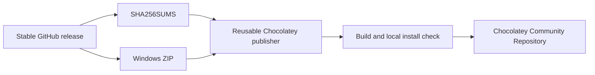

# Chocolatey publishing

Chocolatey packages only publish stable Windows ZIP assets that already belong
to a public GitHub release. The reusable publisher reads the release's
`SHA256SUMS`, verifies the downloaded archive during a real local Chocolatey
install, then optionally pushes the identical `.nupkg` to Chocolatey's
community repository.



Snapshots never call this workflow. Chocolatey packages point only at immutable
stable release assets, so a package never changes under an already published
version.

## One organisation secret

Create one `CHOCOLATEY_API_KEY` organisation secret and scope it only to the
Windows products that publish packages. The publisher still creates and tests
the `.nupkg` when the secret is absent. It then reports `published=false`
instead of contacting Chocolatey.

The Community Repository moderates new packages. A successful push means the
package was submitted. Add a Chocolatey install link to the product page only
after the package is publicly searchable.

## Product call

Call this after the job that creates the public GitHub release:

```yaml
  chocolatey:
    needs: release
    uses: YunaBraska/YunaBraska/.github/workflows/wc_chocolatey_publish.yml@<FULL_COMMIT_SHA>
    with:
      package_id: example
      display_name: Example
      publisher: NanoNative
      version: ${{ needs.version.outputs.version }}
      release_tag: ${{ needs.version.outputs.version }}
      asset_name: example-windows-x64.zip
      executable_path: bin/example.exe
      project_url: https://example.org/
      license_expression: MIT
    secrets: inherit
```

The exact release asset and executable path remain product facts. The common
workflow owns verification, package layout, installation test, publishing and
the optional secret.
