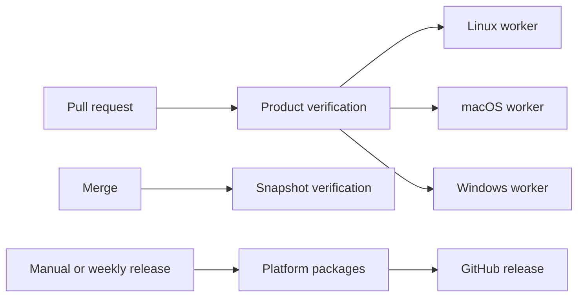

# C++ CI/CD

The public product flow stays small: pull request, merge snapshot, stable release, product pages, App Store package, and explicit App Store upload. A merge snapshot is only a tested one-day Actions artifact. It must not create a Git tag, GitHub release, Homebrew update, Sparkle feed, or App Store package. C++ products use the same release boundary as Swift and .NET, but their compiler and package commands remain product-owned.

## Reusable workers

| Workflow | Owns | Product owns |
| --- | --- | --- |
| `wc_cpp_linux_build.yml` | checkout, container cache, compiler cache, reports and artifacts | Docker image, build, integration and package commands |
| `wc_cpp_macos_build.yml` | native ARM and Intel runners, keychain setup, Developer ID credentials, caches and artifacts | toolchain preparation, tests and app archive command |
| `wc_cpp_windows_build.yml` | MSVC, Qt setup, caches, reports and artifacts | dependency preparation, tests and package command |

The inputs deliberately carry the product build commands. Qt, CMake, Rust bridges, deployment targets, runtime libraries and package layouts are not interchangeable. The worker owns the repeated CI mechanics; the product owns the commands that define its executable behavior.

Use native runners for architectures that execute tests. Do not add QEMU as a substitute for macOS or Linux ARM runtime verification. The worker matrix uses `fail-fast: false` so every platform reports its own result.

## Signing and publication

Snapshot builds never use Apple release credentials. A stable macOS release may import the existing Developer ID certificate, notarize its final archive and sign its direct-update feed. The product release coordinator verifies its exact assets and creates the Homebrew cask input before publication. This prevents a generic workflow from guessing product names, archive contents, update paths or package commands.

When a second C++ product needs the same release-asset contract, extract that publication boundary then. Do not add generic toolchain switches before there is a real second caller.
