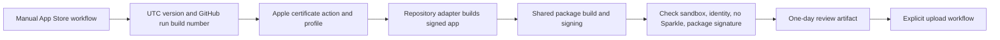

# Mac App Store CI/CD

The direct and Store channels are separate. Direct releases remain Developer ID signed, notarized, and may use signed Sparkle feeds. A Store package is sandboxed, contains no Sparkle framework, and is signed with Mac App Distribution plus Mac Installer Distribution.



The package workflow verifies the final Store bundle's identifier, hardened signature, sandbox entitlement, absence of Sparkle, and signed installer package. GitHub's hosted macOS runners have no usable GUI session, so starting a GUI app there is not a valid acceptance test. User-granted microphone, camera, screen-recording, audio-device, and network behavior remain product acceptance tests in a normal macOS login session.

The package workflow deliberately never uploads a build or submits an App Store version. `wc_macos_app_store_upload.yml` is a separate reusable workflow. A product invokes it only from its explicitly started upload workflow. It validates and uploads the signed package using `xcrun altool`; it never submits a version for App Review.

## Contract

Each Store-ready product calls `wc_macos_app_store.yml` from a manually started `app-store.yml` workflow. The product supplies only its bundle name and Store bundle identifier. It must provide this executable adapter:

```sh
scripts/package-app-store.sh "$APP_STORE_MARKETING_VERSION" "$APP_STORE_BUILD_NUMBER"
```

The adapter receives these environment values:

| Value | Purpose |
| --- | --- |
| `APP_STORE_BUNDLE_ID` | Registered Store identifier. |
| `APP_STORE_MARKETING_VERSION` | UTC `YYYY.M.D`. |
| `APP_STORE_BUILD_NUMBER` | GitHub run ID. It always increases without a manual counter. |
| `APP_STORE_TEAM_ID` | Team from the selected provisioning profile. |
| `MACOS_APP_STORE_APPLICATION_IDENTITY` | Imported Mac App Distribution identity. |
| `MACOS_APP_STORE_PROFILE_NAME` | Imported profile name. |
| `MACOS_APP_STORE_PROFILE_PATH` | Imported profile path. |

It must create this signed app:

```text
dist/app-store/<App>.app
```

The shared workflow then builds the unsigned installer, signs it with the imported Mac Installer Distribution identity, and checks that the bundle ID is exact, the app has the App Sandbox entitlement, no `Sparkle.framework` is embedded, the code signature is valid, and the installer package is signed. The package is retained for one day.

## Secrets

Every participating repository needs these Base64 values. They are Store-specific and do not replace the existing direct-release secrets.

| Secret | Content |
| --- | --- |
| `MACOS_APP_STORE_APPLICATION_CERTIFICATE` | PKCS#12 export of Mac App Distribution. |
| `MACOS_APP_STORE_INSTALLER_CERTIFICATE` | PKCS#12 export of Mac Installer Distribution. |
| `MACOS_APP_STORE_CERTIFICATE_PASSWORD` | Shared PKCS#12 password for both Store certificates. |
| `MACOS_APP_STORE_PROFILE` | Provisioning profile for that product's Store identifier. |

Never commit certificates, profiles, passwords, signing identities, or API keys. The pinned Apple certificate action imports both P12 files into one temporary keychain, keeps the runner trust chain available to Apple signing tools, and removes that keychain after the job. Do not replace this with custom `security` setup unless the action cannot support a required Apple tool.

The explicit upload workflow additionally needs these App Store Connect secrets. They are account-level credentials, not signing credentials, and may be shared only with repositories that are allowed to upload a Store build.

| Secret | Content |
| --- | --- |
| `APP_STORE_CONNECT_API_KEY` | App Store Connect API key ID. |
| `APP_STORE_CONNECT_ISSUER_ID` | App Store Connect issuer ID. |
| `APP_STORE_CONNECT_PRIVATE_KEY` | Downloaded `.p8` API private key. |

Apple requires an app record to be created in App Store Connect before the first upload. The upload produces a processed build. Screenshots, privacy answers, age rating, price, availability, and App Review submission stay separate product decisions.

## Direct updates

Homebrew owns upgrades for Homebrew installations. Direct GitHub downloads can use the signed macOS feed that is attached to every non-snapshot release. The .NET release workflow creates one feed per macOS architecture only when the product passes `macos_update_public_key` and provides `MACOS_UPDATE_PRIVATE_KEY`. The product embeds only the public key. Store builds do not receive a feed or update key.

## Adapter boundaries

Swift, .NET, and C++ need different archive commands. They share the same input, output, signing, validation, versioning, artifact, and publication boundary. Do not add toolchain switches to the reusable workflow. Keep toolchain setup and archive construction inside the product adapter.
