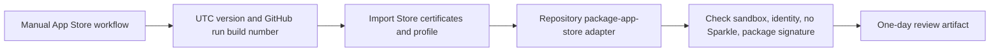

# Mac App Store CI/CD

The direct and Store channels are separate. Direct releases remain Developer ID signed, notarized, and may use Sparkle. A Store package is sandboxed, contains no Sparkle framework, and is signed with Mac App Distribution plus Mac Installer Distribution.



The reusable workflow deliberately builds and validates only. It never uploads a build or submits an App Store version. That remains a separate, explicitly approved publication step.

## Contract

Each Store-ready product calls `wc_macos_app_store.yml` from a manually started `app-store.yml` workflow. The product supplies only its bundle name and Store bundle identifier. It must provide this executable adapter:

```sh
scripts/package-app-store.sh "$APP_STORE_MARKETING_VERSION" "$APP_STORE_BUILD_NUMBER"
```

The adapter receives these environment values:

| Value | Purpose |
| --- | --- |
| `APP_STORE_BUNDLE_ID` | Registered Store identifier. |
| `APP_STORE_MARKETING_VERSION` | UTC `YYYY.M.D`. |
| `APP_STORE_BUILD_NUMBER` | GitHub run ID. It always increases without a manual counter. |
| `APP_STORE_TEAM_ID` | Team from the selected provisioning profile. |
| `MACOS_APP_STORE_APPLICATION_IDENTITY` | Imported Mac App Distribution identity. |
| `MACOS_APP_STORE_INSTALLER_IDENTITY` | Imported Mac Installer Distribution identity. |
| `MACOS_APP_STORE_PROFILE_NAME` | Imported profile name. |
| `MACOS_APP_STORE_PROFILE_PATH` | Imported profile path. |

It must create exactly these review outputs:

```text
dist/app-store/<App>.app
dist/app-store/<App>.pkg
```

The shared workflow checks that the bundle ID is exact, the app has the App Sandbox entitlement, no `Sparkle.framework` is embedded, the code signature is valid, and the installer package is signed. The package is retained for one day.

## Secrets

Every participating repository needs these Base64 values. They are Store-specific and do not replace the existing direct-release secrets.

| Secret | Content |
| --- | --- |
| `MACOS_APP_STORE_APPLICATION_CERTIFICATE` | PKCS#12 export of Mac App Distribution. |
| `MACOS_APP_STORE_APPLICATION_CERTIFICATE_PASSWORD` | PKCS#12 password. |
| `MACOS_APP_STORE_INSTALLER_CERTIFICATE` | PKCS#12 export of Mac Installer Distribution. |
| `MACOS_APP_STORE_INSTALLER_CERTIFICATE_PASSWORD` | PKCS#12 password. |
| `MACOS_APP_STORE_PROFILE` | Provisioning profile for that product's Store identifier. |

Never commit certificates, profiles, passwords, signing identities, or API keys. The runner imports them into a temporary keychain and removes that keychain after the job.

## Adapter boundaries

Swift, .NET, and C++ need different archive commands. They share the same input, output, signing, validation, versioning, artifact, and publication boundary. Do not add toolchain switches to the reusable workflow. Keep toolchain setup and archive construction inside the product adapter.
