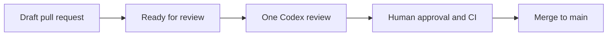

# Pull request review

Every same-repository pull request to `main` receives one Codex review when it
changes from draft to ready for review. The caller contains no checkout and
runs no project command. It only posts the request after the author has
finished the current reviewable change.



Further commits do not start another review. After a material update, request
one deliberately with this pull request comment:

```text
@codex review
```

Codex Code Review must be enabled for the repository in Codex settings. Keep
Codex automatic reviews disabled. The caller owns the `main`-only trigger, so
there is no duplicate review on every push or on non-main pull requests.

Reviews are advisory. Branch protection still requires the project’s human
approval and successful CI.

## Caller

Pin the shared workflow to a full commit SHA:

```yml
name: "💬 CI · Pull Request Review"

on:
  pull_request_target:
    branches: [main]
    types: [ready_for_review]

permissions:
  pull-requests: write

jobs:
  review:
    uses: YunaBraska/YunaBraska/.github/workflows/wc_pull_request_review.yml@<FULL_COMMIT_SHA>
```

`pull_request_target` is safe here because the reusable workflow never checks
out or executes code from the pull request. It rejects fork pull requests and
uses its token only to create the one review-request comment.
