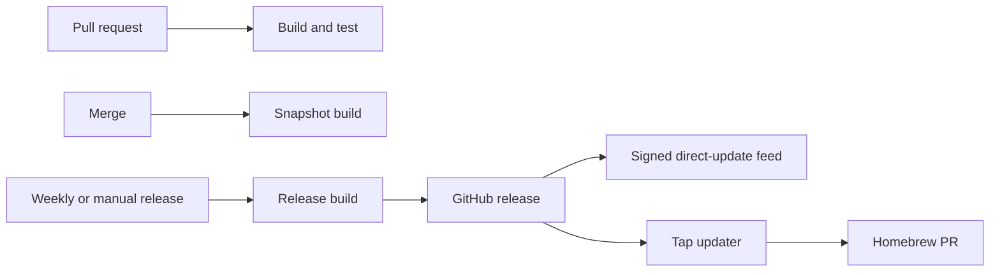

# Swift CI/CD



Every build checks out one commit, resolves one version, tests it, creates a universal macOS app, and writes `dist/<App>-<version>.zip` plus `dist/<App>-<version>.dmg`. The ZIP is the Homebrew asset; the DMG is the direct-install asset.

| Trigger | Version | Result |
| --- | --- | --- |
| Pull request or merge | `next_snapshot` from the latest tag, fallback `0.0.1` | Build only; merge keeps a one-day artifact. |
| Weekly release with source changes | UTC `YYYY.M.D` | Tag, GitHub release, ZIP and DMG. |
| Manual release | Same; `force` permits unchanged source | Same. |

Release detection ignores documentation, tests, examples, and `.github`. It releases for every other changed tracked file. A version with a hyphen is a GitHub pre-release.

Reusable workflows declare the smallest permission ceiling needed by their nested jobs: `contents: read` for the build, and `actions: read` plus `contents: write` for the release. A caller may reduce that ceiling but cannot raise it; this is required for reusable workflows that call another reusable workflow.

## Reuse

```yaml
# build-pr.yml
permissions:
  contents: read

jobs:
  build:
    uses: YunaBraska/YunaBraska/.github/workflows/wc_swift_build_common.yml@<FULL_COMMIT_SHA>
    with:
      ref: ${{ github.event.pull_request.head.sha }}
    secrets: inherit
```

```yaml
# build-merge.yml
permissions:
  contents: read

jobs:
  build:
    uses: YunaBraska/YunaBraska/.github/workflows/wc_swift_build_common.yml@<FULL_COMMIT_SHA>
    with:
      ref: ${{ github.sha }}
      dry_run: true
      upload_artifact: true
    secrets: inherit
```

```yaml
# release.yml
# yuna-release: true
permissions:
  actions: read
  contents: write

jobs:
  release:
    uses: YunaBraska/YunaBraska/.github/workflows/wc_swift_release.yml@<FULL_COMMIT_SHA>
    with:
      force: ${{ inputs.force }}
      macos_update_public_key: ${{ vars.MACOS_UPDATE_PUBLIC_KEY }}
    secrets: inherit
```

`scripts/check.sh` is the repository's test entrypoint. `scripts/package.sh "${VERSION}"` must create the ZIP and DMG in `dist/`. The common workflow deliberately has no packaging knobs.

## Signing

| Build | Behavior | Reason |
| --- | --- | --- |
| Pull request or snapshot | Ad-hoc signature | Test builds do not use release credentials. |
| Release | Developer ID signature and notarization | Requires `MACOS_SIGNING_CERTIFICATE`, `MACOS_SIGNING_CERTIFICATE_PASSWORD`, `MACOS_NOTARY_KEY`, `MACOS_NOTARY_KEY_ID`, and `MACOS_NOTARY_ISSUER_ID`. |

`MACOS_SIGNING_CERTIFICATE` is a base64-encoded PKCS#12 file. `MACOS_NOTARY_KEY` is the raw `.p8` PEM text. Partial configuration fails. Releases require both signing and notarization credentials. Each app's packaging script must sign and notarize its app and DMG and staple the tickets before distributing them. The release build checks the signed app inside every ZIP and validates the tickets for the app and DMG. The runner deletes its temporary keychain and credential files after every build.

## Direct updates

Set the repository variable `MACOS_UPDATE_PUBLIC_KEY` and the repository secret `MACOS_UPDATE_PRIVATE_KEY` to one product-specific Ed25519 key pair. A release validates that the two keys match. Snapshot builds neither embed the public key nor use the private key.

The common build removes the private update key before snapshot packaging. Repository secrets may be inherited by a pull-request workflow, but an unsigned snapshot must not fail because that key has no matching public release key.

The app package owns its Sparkle integration. It embeds the public key and feed URL, packages the Sparkle framework, writes a signed `appcast.xml` for the notarized DMG, and verifies that feed before upload. The common release workflow creates a draft, uploads every file in `dist`, then publishes it. If that upload or publication fails, it deletes its own draft and tag. The appcast and matching DMG therefore become visible together. This keeps product UI and package layout local while sharing key validation and publication.

## Homebrew

The app repository never writes the tap. Add these two markers to its cask or formula:

```ruby
# yuna-release: YunaBraska/example
# yuna-release-asset: Example-{version}.zip
```

The tap daily updater reads the latest stable GitHub release, verifies the asset checksum, and opens one `bot/maintenance-homebrew` PR. Weekly maintenance merges that green PR. See [automation ownership](AUTOMATION.md).

## App Store

Direct distribution and the Mac App Store are separate channels. Direct releases use Developer ID notarization and may use Sparkle. Store builds omit Sparkle, use App Store signing and use the App Store update channel. Apple requires Mac App Store apps to use Mac App Store update mechanisms: <https://developer.apple.com/app-store/review/guidelines/>.
